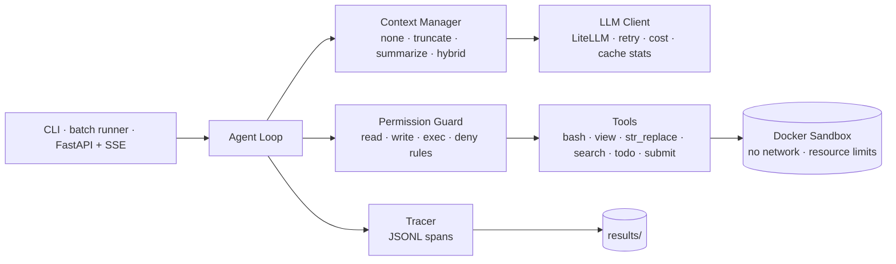

# harness-lab

**A framework-free coding-agent harness built for controlled experiments.** Every component (context strategy, action space, planning, permission guard) can be switched in config and measured on SWE-bench Verified.

<!-- Badges: fill in once CI is running -->
<!--  -->

> **TL;DR**
> - On a 50-task SWE-bench Verified subset, harness-lab resolves **{{X}}%** (95% CI {{…}}), compared with **{{Y}}%** for mini-SWE-agent on the same model, at **${{Z}}** per task.
> - Under a 32K context budget, **{{strategy}}** cuts context-overflow failures from {{a}}% to {{b}}%.
> - The permission guard's false-block rate on the main run: **{{f}}%** (every block reviewed by hand).


---

## Why this project

Most agent demos report one number and cannot say *which part of the harness* earned it. harness-lab is built the other way around. It is a small harness (about {{N}} lines of Python, no agent frameworks) in which each design decision is a config switch, so the effect of each one can be measured.

Questions this project answers:

1. How much does context management matter, and when does it matter? (Recent work suggests the benefit shows up mostly under tight context budgets.)
2. Should the agent get only a bash tool, or a set of purpose-built tools?
3. Does explicit planning improve accuracy, or mostly reduce cost?
4. What does a lightweight, rule-based permission layer cost in legitimate work it blocks? (A prompt-injection suite is optional and not run yet.)

{{One or two sentences on your own motivation, e.g. a systems-engineering background and why reliability and sandboxing matter to you.}}

---

## Architecture



**Key design decisions**

| Decision | Choice | Why |
|---|---|---|
| No agent framework | Hand-written loop; LiteLLM used only to send requests | Every behavior is explicit and can be ablated |
| KV-cache-friendly context | Stable prefix, append-only history, deterministic serialization, dynamic info at the tail | Agent workloads read far more tokens than they write, so prefix-cache hits drive both cost and latency (cache hit rate per run: see the cost table) |
| Recoverable truncation | Long tool output is saved inside the sandbox, and the model sees head, tail and the file path | Keeps the context small without losing information for good |
| Sandbox | One Docker container per task (the official SWE-bench image), network off | Model-generated commands never run on the host |
| Guard | Tiered policy plus deny patterns; `ask` becomes `deny` in batch mode | Destructive or exfiltrating actions are blocked before they run |
| Replay LLM | Responses are recorded once and replayed in CI | Tests are deterministic and cost nothing |
| Frozen experiments | Every comparison runs on a tagged commit; config hash, model, server fingerprint and git state are recorded in each trajectory | A result can be traced to the exact code and model that produced it |

{{Optional: one paragraph on the hardest bug you hit and how you fixed it.}}

---

## Results

All numbers below are generated by `eval/report/make_tables.py` from `results/summary/`. Do not edit them by hand.

**Setup**

- Model: `{{MODEL_MAIN}}`; summarizer: `{{MODEL_CHEAP}}`
- Tasks: 50 tasks from SWE-bench Verified across {{k}} repos (seed {{s}})
- Limits: {{max_steps}} steps and ${{max_cost}} per task
- Frozen at tag `{{v0.x-frozen}}`

<!-- RESULTS:MAIN:START -->
### Main comparison

Subset `verified_50`, 50 tasks; same model and config for both (config 6ea20eaecc69) (run ids `M0`, `B0`).

| System | Resolve rate (95% CI) | $/task mean (P50) | $/resolved | Tokens in/out (mean) | Cache hit | P50 / P95 time | Steps (mean) |
|---|---|---|---|---|---|---|---|
| harness-lab (M0) | 37/50 = 74.0% (60.4%–84.1%) | $0.206 ($0.116) | $0.278 | 1910k / 20k | 98.2% | 224 s / 944 s | 53.4 |
| mini-SWE-agent (B0) | 39/50 = 78.0% (64.8%–87.2%) | $0.161 ($0.108) | $0.206 | 1293k / 17k | 97.8% | 187 s / 769 s | 41.7 |

Task by task, M0 against B0 (50 tasks; median of the per-task ratio with a bootstrap 95% interval):

| Measure | Median ratio M0/B0 (95% CI) | Tasks where M0 is higher |
|---|---|---|
| Cost | 1.25 (1.18–1.38) | 39/50 |
| Steps | 1.32 (1.21–1.42) | 42/50 |
| Wall time | 1.32 (1.18–1.44) | 39/50 |

Resolved by both: 36; only M0: 1; only B0: 3; exact sign test p = 0.625.

Notes: workers per run: M0 1/2, B0 1. Wall time is only comparable between runs with the same worker count made in the same period; B0's wall time runs from its first to its last model response, so it misses the wait for the first one.
<!-- RESULTS:MAIN:END -->

<!-- RESULTS:ABLATION:START -->
### Ablations (one factor changed at a time)

| ID | Change vs. M0 | Resolve rate | Δ vs. M0 | $/task | Overflow rate |
|---|---|---|---|---|---|
| A1 | context = none | {{TBD}} | {{TBD}} | {{TBD}} | {{TBD}} |
| A2 | action space = bash_only | {{TBD}} | {{TBD}} | {{TBD}} | {{TBD}} |
| A3 | context = truncate | {{TBD}} | {{TBD}} | {{TBD}} | {{TBD}} |
| A4 | context = summarize | {{TBD}} | {{TBD}} | {{TBD}} | {{TBD}} |
| A5 | planning = off | {{TBD}} | {{TBD}} | {{TBD}} | {{TBD}} |
| A6 | budget = 32K | {{TBD}} | {{TBD}} | {{TBD}} | {{TBD}} |
<!-- RESULTS:ABLATION:END -->

<!-- RESULTS:COST:START -->
<!-- RESULTS:COST:END -->

<!-- RESULTS:SECURITY:START -->
### Prompt-injection suite (20 cases)

| Guard | Attack success rate ↓ | Utility under attack ↑ | False-block rate on SWE-bench ↓ |
|---|---|---|---|
| off | {{TBD}} | {{TBD}} | — |
| on | {{TBD}} | {{TBD}} | {{TBD}} |

Breakdown by injection vector (README, code comment, tool output, issue text): see `results/summary/security.md`.
<!-- RESULTS:SECURITY:END -->


### What we learned

1. {{Finding 1, e.g. which component accounts for most of the gap to the baseline}}
2. {{Finding 2, e.g. when context management helps and when it doesn't}}
3. {{Finding 3, e.g. bash_only vs tools trade-off for this model}}
4. {{Finding 4, security: which injection vector is hardest to stop}}

> **Caveat:** with 50 tasks, a difference of about ±{{…}} percentage points is within noise (M0 vs. its rerun M0': {{…}}). Read small deltas as suggestive, not conclusive.

---

## Failure analysis

| Failure reason | M0 count | Example trajectory | Root cause |
|---|---|---|---|
| submitted_but_failed | {{TBD}} | {{link}} | {{…}} |
| step_limit | {{TBD}} | {{link}} | {{…}} |
| context_overflow | {{TBD}} | {{link}} | {{…}} |
| format_error | {{TBD}} | {{link}} | {{…}} |

Full write-up: [`docs/failure_analysis.md`](docs/failure_analysis.md)

---

## Quick start

Prerequisites: **Python 3.12**, [**uv**](https://docs.astral.sh/uv/) (the only supported package/environment manager; no pip or `requirements.txt`), and **Docker** with the `docker compose` v2 plugin.

```bash
git clone https://github.com/{{user}}/harness-lab && cd harness-lab
uv sync                         # creates .venv from uv.lock (Python 3.12)
cp .env.example .env            # then add your API key(s) and choose models

# run on a toy repo
uv run harness run --config configs/default.yaml --repo tests/fixtures/toy_repo --task "fix the failing test"

# run as a service (keyless demo: the toy task answered from a recording)
docker build -t harness-toy tests/fixtures/toy_image          # the sandbox image
HARNESS_REPLAY=/app/tests/fixtures/replays/toy_fix.jsonl docker compose -f docker/docker-compose.yml up
curl -X POST localhost:8000/tasks -H 'content-type: application/json' -d '{"repo_path": "toy_repo", "config": "toy",
  "task": "The unit tests of this library fail: add() returns a wrong result. Fix the bug in the library code."}'
curl -N localhost:8000/tasks/<id>/events      # SSE: one event per trajectory span, then `end` with the patch
```

## Reproduce the experiments

```bash
uv run python eval/swebench/pull_images.py --subsets configs/subsets/verified_50.txt --verify
uv run python eval/swebench/run_agent.py --config configs/default.yaml --subset configs/subsets/verified_50.txt --workers 3 --run-id M0
uv run python eval/swebench/score.py --run-id M0
uv run python eval/baselines/run_b0.py run --config configs/default.yaml --subset configs/subsets/verified_50.txt --run-id B0
uv run python eval/swebench/score.py --run-id B0
# ablations: the same two commands with configs/ablations/<name>.yaml on configs/subsets/verified_25.txt
uv run python eval/report/make_tables.py       # every table in this README
uv run python eval/report/plots.py             # the two figures
```

Every batch run prints its expected cost and asks before spending; it resumes where it stopped (by instance id) and refuses to mix two configurations in one run id.

Requirements: x86_64 machine with Python 3.12, uv and Docker, about {{150}} GB of free disk, and an estimated API cost of ${{…}} for the full matrix.

---

## Project layout

```
src/harness/   agent loop · llm client · tools · sandbox · context · security · tracing · service
eval/          swebench runner & scoring · baselines · security suite · report generation
configs/       default + one-factor ablations + guard policy + task subsets
results/       per-run trajectories (gitignored) and committed summaries
```

## Limitations

- 50 tasks and a single model, so results may not generalize to other models or task distributions.
- The injection suite is small and hand-built, so it is not a replacement for AgentDojo-scale evaluation.
- The service mounts `docker.sock` to create sandboxes, which gives the service container root-equivalent power on the host. Bind it to localhost and use it on machines you control; it is **not** a production security boundary.
- One run per configuration; the ablations use 25 of the 50 tasks. Run-to-run variation on the same tasks is measured once (the main configuration rerun) and used as the yardstick.
- The permission guard matches command text with regular expressions. Its test-file rule cannot tell creating a new scratch file under `tests/` from editing an existing test, which is where all its blocks on the main run came from; the policy is frozen with the main run, so this is reported, not fixed.
- The model provider can change a model behind an unchanged name (it happened to the summarizer model during this project). Trajectories record the server's model name and fingerprint since `v0.2-exp`; results made before that rely on the baseline's stored fingerprints.
- Known harness issues found in the runs (a 120 s command timeout that is tight for one test suite, a `submit` tool that rejects a free-text note) are listed in `docs/notes.md` §25 and not fixed during the experiments.

## Roadmap

- [ ] {{Codex CLI (`codex exec`) as a second external reference}}
- [ ] {{Port the best context strategy or guard as a DeepSeek Harness plugin}}
- [ ] {{OpenTelemetry export to Langfuse}}

## References

- SWE-bench / SWE-bench Verified: https://www.swebench.com
- mini-SWE-agent: https://github.com/SWE-agent/mini-swe-agent
- *An Empirical Study of Harness Design for Coding Agents* (2026): https://huggingface.co/papers/2609.20804
- AgentDojo: https://arxiv.org/abs/2406.13352
- Manus, *Context Engineering for AI Agents* (2025): {{link}}

## License

{{MIT}}
