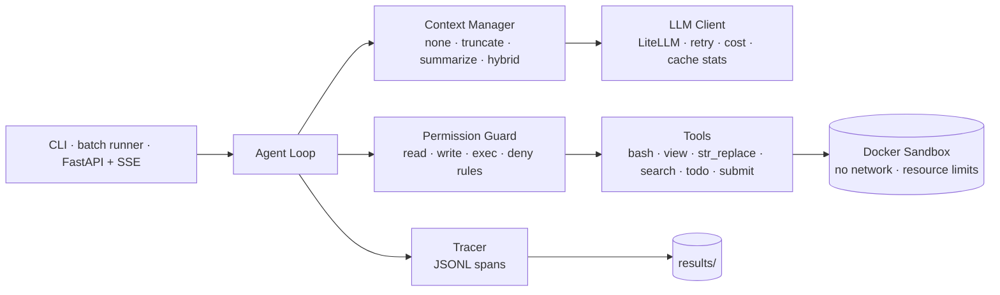
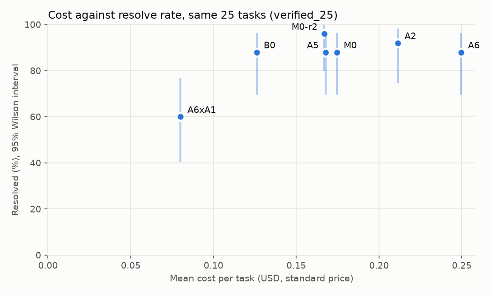
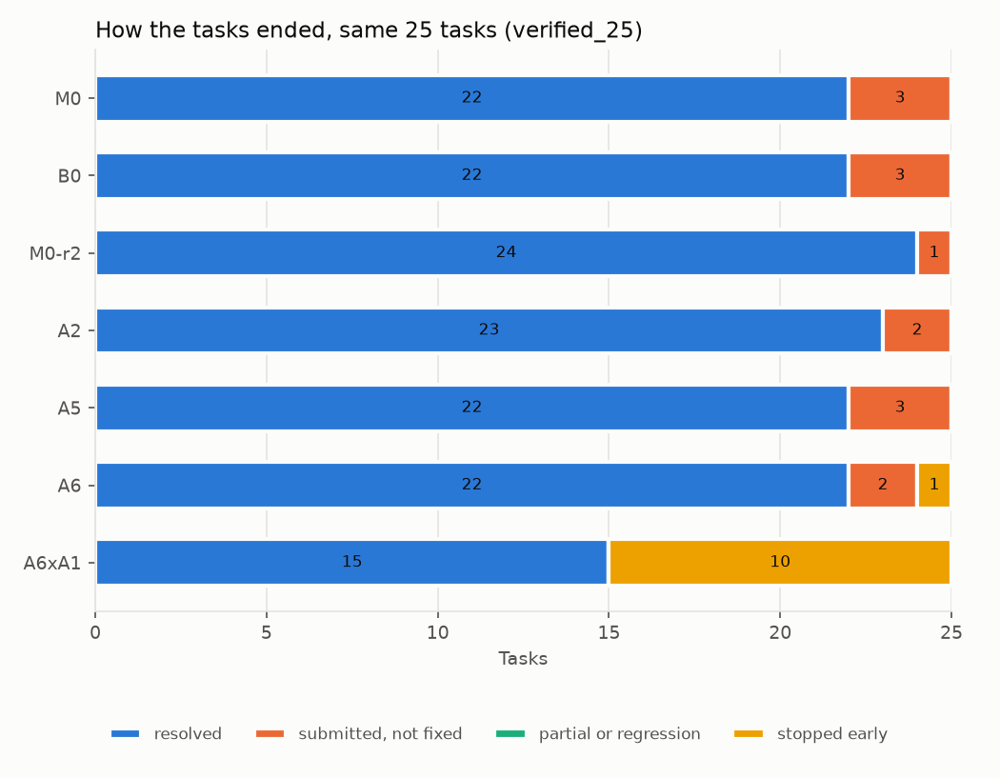

# harness-lab

**A framework-free coding-agent harness built for controlled experiments.** Every component (context strategy, action space, planning, permission guard) can be switched in config and measured on SWE-bench Verified.

<!-- Badges: fill in once CI is running -->
<!--  -->

<!-- RESULTS:TLDR:START -->
> **TL;DR** (every number here is generated by `eval/report/make_tables.py`)
> - On 50 SWE-bench Verified tasks (`verified_50`), harness-lab resolves **37/50 (74.0%, 95% CI 60.4%–84.1%)** and mini-SWE-agent **39/50 (78.0%, 95% CI 64.8%–87.2%)** with the same model and limits: indistinguishable (exact sign test p = 0.625). harness-lab costs **$0.206** per task against **$0.161** (task-by-task cost ratio 1.25 (1.18–1.38), steps ratio 1.32 (1.21–1.42)).
> - Under a 32K context budget, compaction (hybrid) takes context-overflow failures from **60.0%** (no compaction) to **0.0%**, and resolves 7 tasks the run without it misses (0 the other way; p = 0.016; 25 tasks).
> - Prompt-cache hit rate on the main run: **98.2%** of input tokens.
> - Permission guard false-block rate on the main run: **0.25%** of tool calls (7 of 7 blocks judged false after review, 0 unreviewed; rules that fired: `deny.test_edit_bash`).
<!-- RESULTS:TLDR:END -->

---

## Why this project

Most agent demos report one number and cannot say *which part of the harness* earned it. harness-lab is built the other way around. It is a small harness (no agent frameworks; its size is in the setup below) in which each design decision is a config switch, so the effect of each one can be measured.

Questions this project answers:

1. How much does context management matter, and when does it matter? (Recent work suggests the benefit shows up mostly under tight context budgets.)
2. Should the agent get only a bash tool, or a set of purpose-built tools?
3. Does explicit planning improve accuracy, or mostly reduce cost?
4. What does a lightweight, rule-based permission layer cost in legitimate work it blocks? (A prompt-injection suite is optional and not run yet.)

---

## Architecture



**Key design decisions**

| Decision | Choice | Why |
|---|---|---|
| No agent framework | Hand-written loop; LiteLLM used only to send requests | Every behavior is explicit and can be ablated |
| KV-cache-friendly context | Stable prefix, append-only history, deterministic serialization, dynamic info at the tail | Agent workloads read far more tokens than they write, so prefix-cache hits drive both cost and latency (cache hit rate per run: see the cost table) |
| Recoverable truncation | Long tool output is saved inside the sandbox, and the model sees head, tail and the file path | Keeps the context small without losing information for good |
| Sandbox | One Docker container per task (the official SWE-bench image), network off | Model-generated commands never run on the host |
| Guard | Tiered policy plus deny patterns; `ask` asks the user on a terminal (`harness run`) and becomes `deny` in batch runs and the service | Destructive or exfiltrating actions are blocked before they run |
| Replay LLM | Responses are recorded once and replayed in CI | Tests are deterministic and cost nothing |
| Frozen experiments | Every comparison runs on a tagged commit; config hash, model, server fingerprint and git state are recorded in each trajectory | A result can be traced to the exact code and model that produced it |

**A bug worth telling.** Context compaction decides when to compress from an estimate of the prompt size. The estimate left out the model's own earlier reasoning that is sent back with every turn, on the belief that the provider does not count it; a controlled check against the provider's numbers showed that it does. Compactions that looked safe on paper landed far from their target. The fix counted the returned reasoning locally, and the reports now take the size after a compaction from the provider's count of the next request rather than from the estimate (`docs/notes.md` §17).

---

## Results

All numbers below are generated by `eval/report/make_tables.py` from `results/summary/`. Do not edit them by hand.

<!-- RESULTS:SETUP:START -->
**Setup**

- Model: `deepseek/deepseek-v4-pro` (thinking enabled, effort high); summarizer: `deepseek/deepseek-flash` (called only when a context strategy writes a summary)
- Tasks: `verified_50`, 50 tasks from SWE-bench Verified across 4 repos (django 18, scikit-learn 9, sphinx-doc 9, sympy 14); seed 42, dataset revision `78f471bf655a`. The ablations use `verified_25`, half of these drawn by repo
- Limits per task: 150 steps, $2.000, 1800 s; context budget 128000 tokens
- Main run: commits `77f0d9e` (v0.1.1); `ff11f3b` (v0.1-frozen); config hash 6ea20eaecc69
- Harness size: 5509 non-blank lines of Python in `src/harness`
- API cost of the runs in these tables (M0, B0, M0-r2, A2, A5, A6, A6xA1): $40.230 at standard prices
<!-- RESULTS:SETUP:END -->

<!-- RESULTS:MAIN:START -->
### Main comparison

Subset `verified_50`, 50 tasks; same model and config for both (config 6ea20eaecc69) (run ids `M0`, `B0`).

| System | Resolve rate (95% CI) | $/task mean (P50) | $/resolved | Tokens in/out (mean) | Cache hit | P50 / P95 time | Steps (mean) |
|---|---|---|---|---|---|---|---|
| harness-lab (M0) | 37/50 = 74.0% (60.4%–84.1%) | $0.206 ($0.116) | $0.278 | 1910k / 20k | 98.2% | 224 s / 944 s | 53.4 |
| mini-SWE-agent (B0) | 39/50 = 78.0% (64.8%–87.2%) | $0.161 ($0.108) | $0.206 | 1293k / 17k | 97.8% | 187 s / 769 s | 41.7 |

Task by task, M0 against B0 (50 tasks; median of the per-task ratio with a bootstrap 95% interval):

| Measure | Median ratio M0/B0 (95% CI) | Tasks where M0 is higher | Differs |
|---|---|---|---|
| Cost | 1.25 (1.18–1.38) | 39/50 | higher |
| Steps | 1.32 (1.21–1.42) | 42/50 | higher |
| Wall time | 1.32 (1.18–1.44) | 39/50 | higher (descriptive only, see notes) |

Resolved by both: 36; only M0: 1; only B0: 3; exact sign test p = 0.625.

Rule: a cost or steps ratio counts as a difference when its 95% interval excludes 1 (docs/notes.md section 22.9; adopted after the first results, replacing a rule that compared intervals with the noise interval and depended on the ratio's direction). Check: the main configuration run twice does not differ by this rule (every noise-row interval contains 1).

Notes: workers per run: M0 1/2, B0 1. Wall time is only comparable between runs with the same worker count made in the same period; B0's wall time runs from its first to its last model response, so it misses the wait for the first one.
<!-- RESULTS:MAIN:END -->

<!-- RESULTS:ABLATION:START -->
### Ablations (one factor changed at a time)

Each ablation against `M0-r2` (the main configuration rerun on the same commit with the same worker count) on the ablation's own tasks; ratios are medians of the per-task ratio with a bootstrap 95% interval. "Only abl / only base" counts the tasks only one side resolved, with an exact sign test.

| ID | Change vs. M0 | Tasks | Resolved | Only abl / only base | $/task | Cost ratio | Steps ratio | Differs (cost / steps) | Overflow rate |
|---|---|---|---|---|---|---|---|---|---|
| A2 | action space = bash only | 25 (`verified_25`) | 23/25 (base 24) | 1 / 2 (p = 1) | $0.211 | 1.29 (1.05–1.41) | 1.11 (1.04–1.29) | higher / higher | 0.0% |
| A5 | planning = off | 25 (`verified_25`) | 22/25 (base 24) | 0 / 2 (p = 0.5) | $0.168 | 1.05 (0.84–1.27) | 1.07 (0.81–1.26) | no / no | 0.0% |
| A6 | context budget = 32k (hybrid) | 25 (`verified_25`) | 22/25 (base 24) | 0 / 2 (p = 0.5) | $0.250 | 1.33 (0.99–1.60) | 1.13 (1.00–1.36) | no / no | 0.0% |
| A6xA1 | context budget = 32k, context = none | 25 (`verified_25`) | 15/25 (base 24) | 0 / 9 (p = 0.0039) | $0.080 | 0.71 (0.53–0.86) | 0.71 (0.56–0.86) | lower / lower | 60.0% |
| (noise) | none: `M0` against `M0-r2`, same config | 25 | — | 0 / 2 (p = 0.5) | — | 1.04 (0.88–1.30) | 1.00 (0.93–1.21) | no / no | — |
| (noise) | none: `M0-r2` against `M0`, same config | 25 | — | 2 / 0 (p = 0.5) | — | 0.96 (0.77–1.13) | 1.00 (0.83–1.08) | no / no | — |

Not run: A1, A3, A4. `M0-r2` compacted in 0 of its tasks at the 128k budget, so at that budget the context strategy never acts.
Context pressure (32k): A6 (compaction on) against A6xA1 (off) on the same tasks: overflow 0.0% vs 60.0%; resolved only with compaction / only without: 7 / 0 (p = 0.016); cost ratio 2.03 (1.24–2.86), steps ratio 1.59 (1.14–2.12) (runs that overflow stop early, so they are cheaper).
Rule: a cost or steps ratio counts as a difference when its 95% interval excludes 1 (docs/notes.md section 22.9; adopted after the first results, replacing a rule that compared intervals with the noise interval and depended on the ratio's direction).
The two noise rows are the same pair of runs of the main configuration, each way round (the direction of a ratio is arbitrary). Check: the main configuration run twice does not differ by this rule (every noise-row interval contains 1). One run per configuration.
<!-- RESULTS:ABLATION:END -->

<!-- RESULTS:COST:START -->
### Cost

Standard (peak) price for every token, the same formula for all runs (`llm/cost.py`).

| Run | Tasks | Total | $/task mean (P50) | $/resolved | Tokens in/out (mean) | Cache hit | Compaction share | Steps |
|---|---|---|---|---|---|---|---|---|
| M0 | 50 (`verified_50`) | $10.293 | $0.206 ($0.116) | $0.278 | 1910k / 20k | 98.2% | 0.0% | 53.4 |
| B0 | 50 (`verified_50`) | $8.046 | $0.161 ($0.108) | $0.206 | 1293k / 17k | 97.8% | — | 41.7 |
| M0-r2 | 25 (`verified_25`) | $4.173 | $0.167 ($0.122) | $0.174 | 1384k / 18k | 98.1% | — | 47.5 |
| A2 | 25 (`verified_25`) | $5.282 | $0.211 ($0.141) | $0.230 | 1847k / 21k | 98.1% | 0.0% | 54.4 |
| A5 | 25 (`verified_25`) | $4.191 | $0.168 ($0.120) | $0.191 | 1419k / 18k | 98.0% | — | 47.3 |
| A6 | 25 (`verified_25`) | $6.241 | $0.250 ($0.178) | $0.284 | 1132k / 20k | 92.4% | 4.2% | 59.8 |
| A6xA1 | 25 (`verified_25`) | $2.003 | $0.080 ($0.087) | $0.134 | 470k / 8.6k | 95.8% | — | 29.0 |

Where the calls go (per task; classes from the command text, `aggregate.py`):

| Run | Explore | Run scripts | Run tests | Edit source | Todo | Tasks with one source edit | Responses with several calls |
|---|---|---|---|---|---|---|---|
| M0 | 29.8 | 12.9 | 5.1 | 2.5 | 1.7 | 24/50 | 4.0% |
| B0 | 24.3 | 10.5 | 3.9 | 1.8 | 0.0 | 32/50 | 5.4% |
<!-- RESULTS:COST:END -->

<!-- RESULTS:SECURITY:START -->
### Permission guard

Prompt-injection suite: not run (optional, plan.md).

| Run | Tasks | Guard checks (bash) | Blocks | Reviewed: false / true / unreviewed | False-block rate (all calls) | False-block rate (bash) |
|---|---|---|---|---|---|---|
| M0 | 50 | 2793 (1916) | 7 | 7 / 0 / 0 | 0.25% | 0.37% |

Every block was reviewed by hand (docs/failure_analysis.md); the rule matches commands by text, so it is defence in depth, not a proof. The sandbox (no network, resource caps) is the boundary.
<!-- RESULTS:SECURITY:END -->




### What we learned

1. **Same resolve rate as mini-SWE-agent, at a higher cost.** On the same model, tasks and limits the two resolve rates cannot be told apart, while harness-lab costs more and takes more steps per task (the task-by-task intervals exclude 1). The extra steps are not from the purpose-built tools: the bash-only ablation is not cheaper, it costs more. Nor from planning: turning it off changes nothing measurable. A follow-up decomposition in the bash-only setting found part of it: switching to mini-SWE-agent's prompt removes some of the extra steps, mostly extra exploration and checking; aligning the remaining harness mechanics (result format, output cut-off, the step note, parallel tool calls, the guard) changed nothing measurable; what is left cannot be told apart from rerun noise on 25 tasks, so its source is not identified (`docs/notes.md` §27–29).
2. **Context management pays off only under context pressure.** At the 128K budget the main configuration almost never compacts, so the context strategy cannot matter there. Under a 32K budget, compaction is the difference between finishing and running out of context: without it most runs overflow, with it none do, and the compacting run resolves more tasks. Compaction itself is a small share of the cost; against the 128K run its visible price is a lower prompt-cache hit rate, while cost and steps cannot be told apart by the rule above.
3. **Purpose-built tools are not a clear win on cost.** Dropping `view`, `str_replace`, `search` and `todo` leaves the resolve rate where it was; in the single-run ablation above it raised cost, but pooling the repeated runs of both configurations did not reproduce that difference (`docs/notes.md` §29).
4. **The permission guard's false blocks all come from one rule.** Every block on the main run was the test-file rule refusing a *new* scratch file under `tests/`, which it cannot tell from editing an existing test. No block hit a dangerous command, because none was attempted; the prompt-injection suite that would test that side is optional and not run. The rule was fixed afterwards (policy v2, see Limitations).

<!-- RESULTS:CAVEAT:START -->
> **Caveat:** the main configuration run twice on the same 25 tasks (`M0`, `M0-r2`) resolved 22 and 24; 2 tasks flipped. Differences of a few tasks are noise at this size; resolve rates are compared only with the sign test on the tasks one side resolved, and each configuration was run once.
<!-- RESULTS:CAVEAT:END -->

---

## Failure analysis

<!-- RESULTS:FAILURES:START -->
How the unresolved tasks of `M0` ended (13 of 50; classes from the run and the official test report, owners from a manual review):

| Ending / tests | Count | Tasks |
|---|---|---|
| submitted_but_failed / partial_fix | 2 | `django__django-11477`, `sphinx-doc__sphinx-7462` |
| submitted_but_failed / regression | 1 | `django__django-15957` |
| submitted_but_failed / target_fail | 10 | `django__django-11087`, `django__django-11734`, `django__django-12273`, `django__django-12663`, `scikit-learn__scikit-learn-14629`, `scikit-learn__scikit-learn-14983`, `sphinx-doc__sphinx-9461`, `sphinx-doc__sphinx-9602`, `sympy__sympy-13798`, `sympy__sympy-21930` |

Owner after manual review: model 13. Loop suspects (the same call repeated several times in a row): 0.
<!-- RESULTS:FAILURES:END -->

The common patterns: a fix placed in a caller or the wrong layer, a fix that covers only part of a multi-file change, and hidden tests that check an exact output the model produced differently. Full write-up: [`docs/failure_analysis.md`](docs/failure_analysis.md)

---

## Quick start

Prerequisites: **Python 3.12**, [**uv**](https://docs.astral.sh/uv/) (the only supported package/environment manager; no pip or `requirements.txt`), and **Docker** with the `docker compose` v2 plugin.

```bash
git clone https://github.com/Yuhehe/harness_demo && cd harness_demo
uv sync                         # creates .venv from uv.lock (Python 3.12)
docker build -t harness-toy tests/fixtures/toy_image          # the sandbox image for local repositories
cp .env.example .env            # then add your API key(s) and choose models (see below)

# run on a toy repo (real API calls)
uv run harness run --config configs/default.yaml --repo tests/fixtures/toy_repo --task "fix the failing test"

# run as a service (keyless demo: the toy task answered from a recording)
HARNESS_REPLAY=/app/tests/fixtures/replays/toy_fix.jsonl docker compose -f docker/docker-compose.yml up
curl -X POST localhost:8000/tasks -H 'content-type: application/json' -d '{"repo_path": "toy_repo", "config": "toy",
  "task": "The unit tests of this library fail: add() returns a wrong result. Fix the bug in the library code."}'
curl -N localhost:8000/tasks/<id>/events      # SSE: one event per trajectory span, then `end` with the patch
```

**Models and keys.** The results here use DeepSeek through LiteLLM's `deepseek/` route: `MODEL_MAIN=deepseek/deepseek-v4-pro`, `MODEL_CHEAP=deepseek/deepseek-flash`, with `DEEPSEEK_API_KEY` and `DEEPSEEK_API_BASE=https://api.deepseek.com` in `.env`. `.env.example` shows the generic OpenAI-compatible form (`openai/<model>` with `OPENAI_API_KEY` / `OPENAI_API_BASE`). Costs come from a fixed price table (`src/harness/llm/cost.py`) that lists only those two DeepSeek models; the budget guard refuses to run a model without a price, so add an entry there before using any other model. `uv run pytest -q` needs no key: the tests use fakes and recordings and never read `.env`.

### MCP servers (optional)

Tools from [MCP](https://modelcontextprotocol.io) servers can be added in the config. Each server runs **inside the sandbox** (started with stdin/stdout attached, no network), its tools are listed once when the task starts and named `mcp__<server>__<tool>`, and every tool not on the server's `allow` list needs approval: asked on a terminal, refused in batch runs.

```yaml
mcp:
  servers:
    - name: notes
      command: [python3, /opt/mcp/notes_server.py]   # must exist in the sandbox image
      allow: [search]                                  # the others need approval
```

The protocol is the official `mcp` SDK; the transport, naming, permissions and lifecycle are this harness's (`src/harness/tools/mcp.py`, `docs/notes.md` §32).

### Export traces to Langfuse (optional)

Every run already writes its full trajectory as JSONL. To also see it as a trace tree (each model call with its tokens and cost, each tool call with its arguments, result and permission decision), export it over OpenTelemetry to any OTLP/HTTP backend, e.g. Langfuse:

```bash
export HARNESS_OTEL=1
export OTEL_EXPORTER_OTLP_ENDPOINT=https://cloud.langfuse.com/api/public/otel
export OTEL_EXPORTER_OTLP_HEADERS="Authorization=Basic $(echo -n "$LANGFUSE_PUBLIC_KEY:$LANGFUSE_SECRET_KEY" | base64 -w 0),x-langfuse-ingestion-version=4"
```

The export is off by default and never changes a run: spans are sent in the background, so a slow or unreachable collector costs nothing but the lost spans. Mapping and caveats: `src/harness/tracing/otel.py`, `docs/notes.md` §31.

## Reproduce the experiments

```bash
uv run python eval/swebench/pull_images.py --subsets configs/subsets/verified_50.txt --verify
uv run python eval/swebench/run_agent.py --config configs/default.yaml --subset configs/subsets/verified_50.txt --workers 3 --run-id M0
uv run python eval/swebench/score.py --run-id M0
uv run python eval/baselines/run_b0.py run --config configs/default.yaml --subset configs/subsets/verified_50.txt --run-id B0
uv run python eval/swebench/score.py --run-id B0
# ablations: the same two commands with configs/ablations/<name>.yaml on configs/subsets/verified_25.txt
uv run python eval/report/make_tables.py       # every table in this README
uv run python eval/report/plots.py             # the two figures
```

Every batch run prints its expected cost and asks before spending; it resumes where it stopped (by instance id) and refuses to mix two configurations in one run id. The run data (`results/runs/`, trajectories and logs) is not committed, so in a fresh clone `make_tables.py` stops at "no trajectories" until the runs are made again; every number in this README is kept with its source in the committed `results/summary/*.json`.

Requirements: an x86_64 machine with Python 3.12, uv and Docker, disk space for the SWE-bench images (tens of GB for the 55 images used here; measurements in `docs/notes.md` §7), and an API budget; the setup above lists what the runs in these tables cost.

---

## Project layout

```
src/harness/   agent loop · llm client · tools · sandbox · context · security · tracing · service
eval/          swebench runner & scoring · baselines · security suite · report generation
configs/       default + one-factor ablations + guard policy + task subsets
results/       per-run trajectories (gitignored) and committed summaries
```

## Limitations

- 50 tasks and a single model, so results may not generalize to other models or task distributions.
- The prompt-injection suite was not run: the permission guard is measured only on false blocks, not on attacks. The sandbox (no network, resource limits, unprivileged) is the security boundary; the guard is defense in depth.
- The service mounts `docker.sock` to create sandboxes, which gives the service container root-equivalent power on the host. Files it writes under `results/service/` are owned by root. Bind it to localhost and use it on machines you control; it is **not** a production security boundary.
- One run per configuration in the tables above; the ablations use 25 of the 50 tasks. Run-to-run variation on the same tasks is measured once (the main configuration rerun) and used as the yardstick. Later exploratory reruns (the baseline three times, some configurations twice) are pooled only in `docs/notes.md` §29.
- The permission guard matches command text with regular expressions. In the policy frozen with the main run, its test-file rule could not tell creating a new scratch file under `tests/` from editing an existing test, which is where all its blocks on the main run came from. Policy v2 (`v0.4-exp`) protects only the test files git tracked when the task started; checked call by call against the recorded runs it lets those calls through and blocks nothing new (`docs/notes.md` §30). The main run was not rerun, so the false-block rate above is the frozen policy's.
- The model provider can change a model behind an unchanged name (it happened to the summarizer model during this project). Trajectories record the server's model name and fingerprint since `v0.2-exp`; results made before that rely on the baseline's stored fingerprints.
- Known harness issues found in the runs (a 120 s command timeout that is tight for one test suite, a `submit` tool that rejects a free-text note) are listed in `docs/notes.md` §25 and not fixed during the experiments.

## Roadmap

- [x] Find where the cost gap to mini-SWE-agent comes from: prompt swap and all alignable harness mechanics tested; the prompt explains part of it, the mechanics nothing measurable, the rest is within rerun noise (`docs/notes.md` §29)
- [ ] Prompt-injection suite with canary-based checks (guard on and off)
- [ ] Codex CLI (`codex exec`) as a second external reference
- [ ] Fix the issues the runs exposed (`docs/notes.md` §25) in a new tagged version, and rerun
- [ ] OpenTelemetry export to Langfuse

## References

- SWE-bench / SWE-bench Verified: https://www.swebench.com
- mini-SWE-agent: https://github.com/SWE-agent/mini-swe-agent
- *An Empirical Study of Harness Design for Coding Agents* (2026): https://huggingface.co/papers/2609.20804
- AgentDojo: https://arxiv.org/abs/2406.13352
- Manus, *Context Engineering for AI Agents: Lessons from Building Manus* (2025): https://manus.im/blog/Context-Engineering-for-AI-Agents-Lessons-from-Building-Manus

## License

MIT. See [`LICENSE`](LICENSE).
